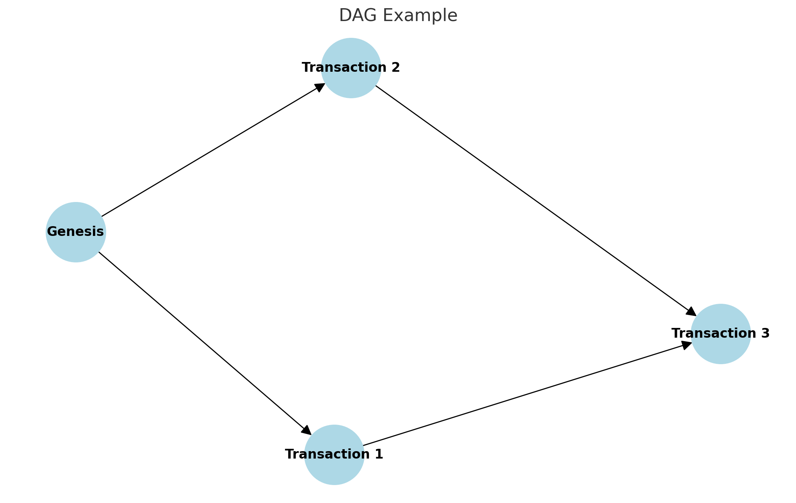

# DAG Ledger Model


A DAG (Directed Acyclic Graph) pattern is a structure based on a directed acyclic graph, widely used in blockchain and Distributed Ledger Technology (DLT). Unlike traditional chain-based blockchains, the DAG pattern has its own unique advantages in transaction confirmation and processing. IOTA is a typical cryptocurrency and Internet of Things (IoT) platform based on the DAG pattern, whose main structure is called the Tangle.

### Advantages of the DAG Pattern

1. **High Throughput**:
   - In a DAG, every new transaction must verify preceding transactions, and this parallel processing increases the system's throughput.

2. **Low Fees**:
   - Because every participant helps verify other transactions, the system does not need miners, reducing transaction fees.

3. **Scalability**:
   - The DAG structure allows unlimited scaling of nodes and transaction volume, suitable for high-frequency transaction scenarios such as micropayments between IoT devices.

4. **Fast Confirmation**:
   - The DAG structure enables transactions to be confirmed quickly, because new transactions verify multiple preceding transactions, forming faster consensus.

### Example Code

Below is a simple DAG structure code example, showing how to add and verify transactions. This example is primarily for illustrating the basic working principles of a DAG.

```go
package main

import (
	"crypto/sha256"
	"fmt"
	"sync"
)

// Transaction represents a simple transaction
type Transaction struct {
	ID      string
	Content string
	Parents []string
}

// DAG represents a directed acyclic graph
type DAG struct {
	mu           sync.Mutex
	transactions map[string]*Transaction
}

// NewDAG creates a new empty DAG
func NewDAG() *DAG {
	return &DAG{
		transactions: make(map[string]*Transaction),
	}
}

// AddTransaction adds a new transaction to the DAG
func (dag *DAG) AddTransaction(content string, parents []string) *Transaction {
	dag.mu.Lock()
	defer dag.mu.Unlock()

	tx := &Transaction{
		ID:      generateID(content),
		Content: content,
		Parents: parents,
	}
	dag.transactions[tx.ID] = tx
	return tx
}

// VerifyTransaction verifies a transaction in the DAG
func (dag *DAG) VerifyTransaction(tx *Transaction) bool {
	dag.mu.Lock()
	defer dag.mu.Unlock()

	for _, parentID := range tx.Parents {
		if _, exists := dag.transactions[parentID]; !exists {
			return false
		}
	}
	return true
}

// generateID generates a simple hash ID for a transaction
func generateID(content string) string {
	hash := sha256.Sum256([]byte(content))
	return fmt.Sprintf("%x", hash)
}

func main() {
	dag := NewDAG()

	// Adding genesis transaction (root of the DAG)
	genesis := dag.AddTransaction("Genesis Transaction", nil)
	fmt.Println("Added genesis transaction:", genesis.ID)

	// Adding transactions referencing the genesis transaction
	tx1 := dag.AddTransaction("Transaction 1", []string{genesis.ID})
	fmt.Println("Added transaction:", tx1.ID, "with parent:", genesis.ID)

	tx2 := dag.AddTransaction("Transaction 2", []string{genesis.ID})
	fmt.Println("Added transaction:", tx2.ID, "with parent:", genesis.ID)

	// Adding a transaction referencing both tx1 and tx2
	tx3 := dag.AddTransaction("Transaction 3", []string{tx1.ID, tx2.ID})
	fmt.Println("Added transaction:", tx3.ID, "with parents:", tx1.ID, tx2.ID)

	// Verifying transactions
	fmt.Println("Verifying tx3:", dag.VerifyTransaction(tx3)) // Should be true
	fmt.Println("Verifying a fake transaction:", dag.VerifyTransaction(&Transaction{ID: "fake", Parents: []string{"fake"}})) // Should be false
}
```

### Code Explanation

1. **Transaction Structure**: Represents a simple transaction, containing the transaction ID, content, and a list of parent transaction IDs.
2. **DAG Structure**: Represents a directed acyclic graph, containing a set of transactions and a mutex for concurrency control.
3. **AddTransaction Method**: Adds a new transaction to the DAG and generates the transaction ID.
4. **VerifyTransaction Method**: Verifies whether a transaction's parent transactions exist in the DAG.
5. **generateID Method**: Generates a simple transaction ID (hash value).

### Summary

This example demonstrates how the DAG pattern is used to process transactions, showing its advantages of high throughput, low fees, scalability, and fast confirmation. Projects like IOTA use this pattern to solve the scalability and efficiency problems of traditional blockchains, making it more suitable for high-frequency transactions and IoT applications.



The figure above shows a simple DAG diagram, containing the following nodes and edges:

- **Nodes**:
  - Genesis (starting node)
  - Transaction 1
  - Transaction 2
  - Transaction 3

- **Edges**:
  - Genesis -> Transaction 1
  - Genesis -> Transaction 2
  - Transaction 1 -> Transaction 3
  - Transaction 2 -> Transaction 3

In this diagram, the Genesis node is the starting node, representing the first transaction. Transaction 1 and Transaction 2 both reference the Genesis transaction, forming parallel branches. Transaction 3 references Transaction 1 and Transaction 2, demonstrating the DAG structure's parallel processing capability and fast confirmation characteristics.

This simple DAG diagram helps in understanding the DAG model's advantages in high throughput and parallel processing. Unlike traditional chain-based blockchains, the DAG model allows multiple transactions to be processed in parallel, thereby improving the overall performance and efficiency of the system.
